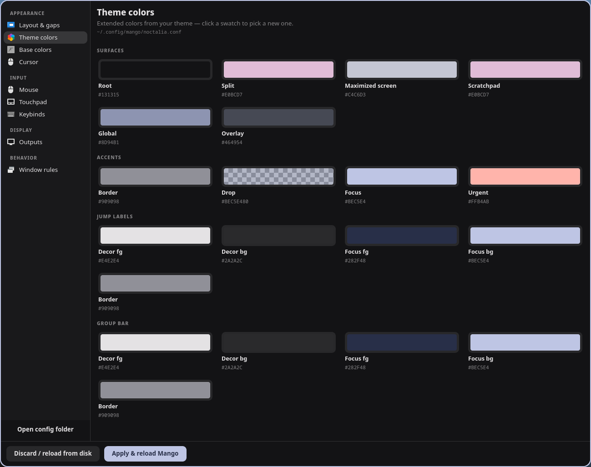
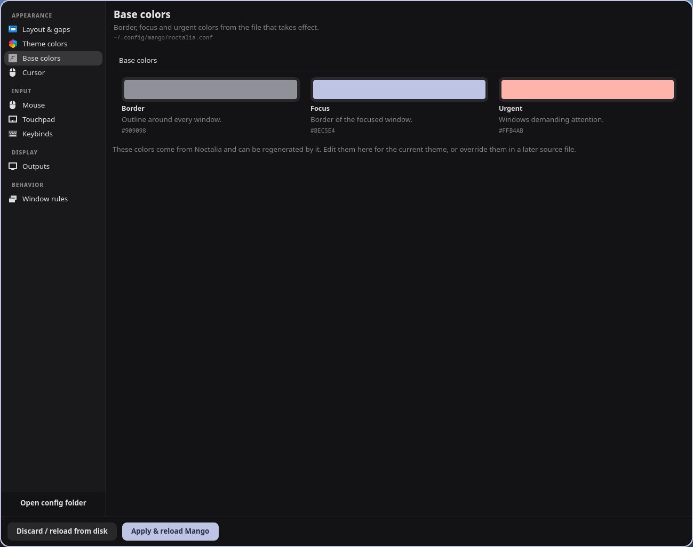
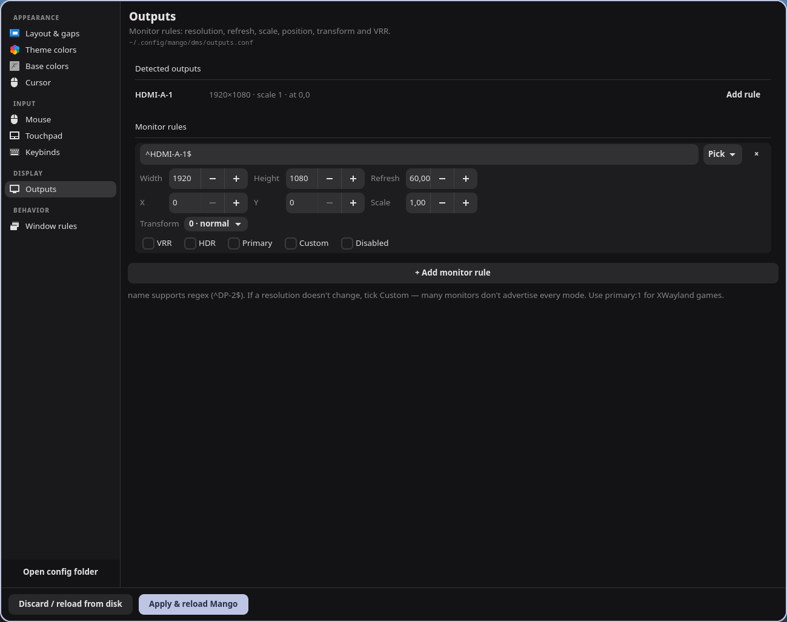
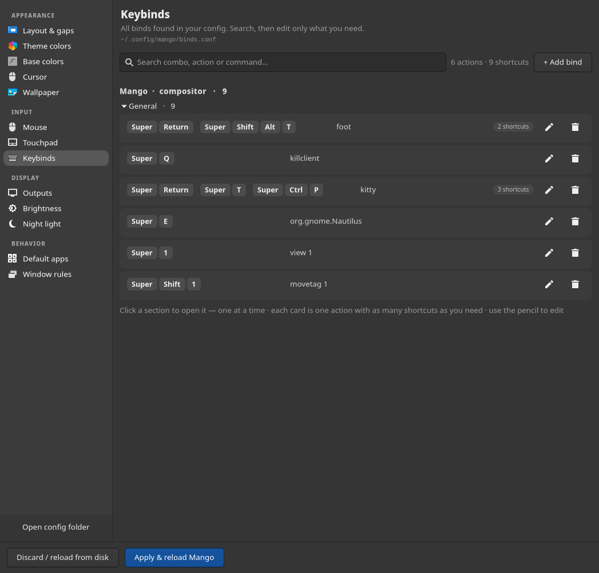
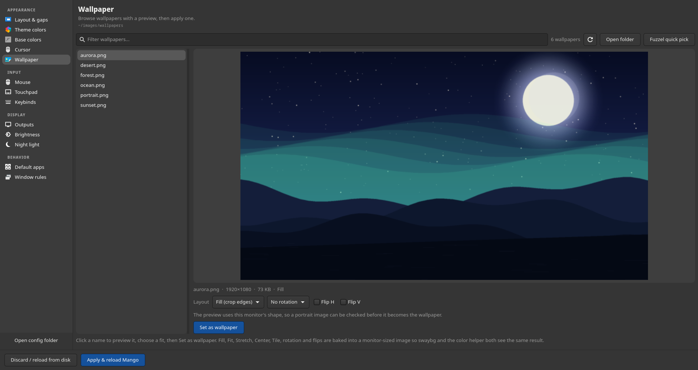
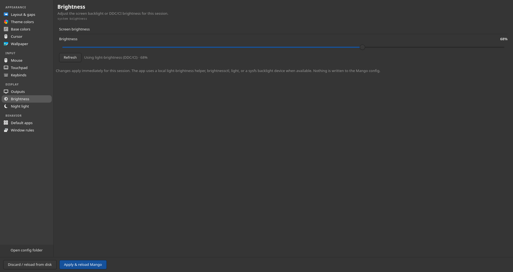
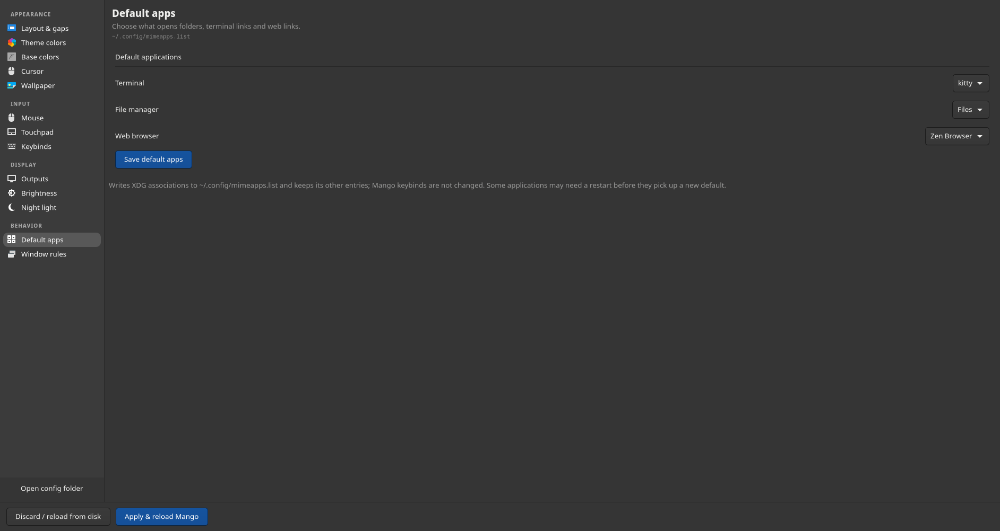
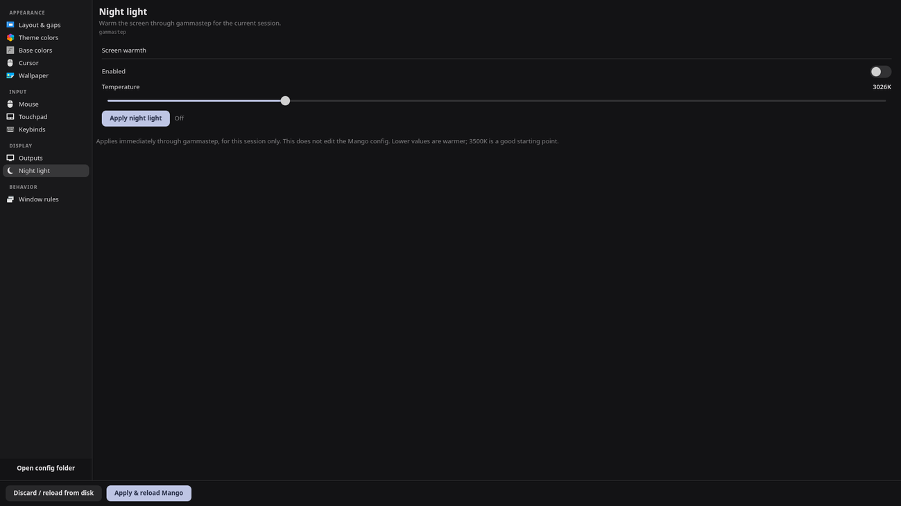
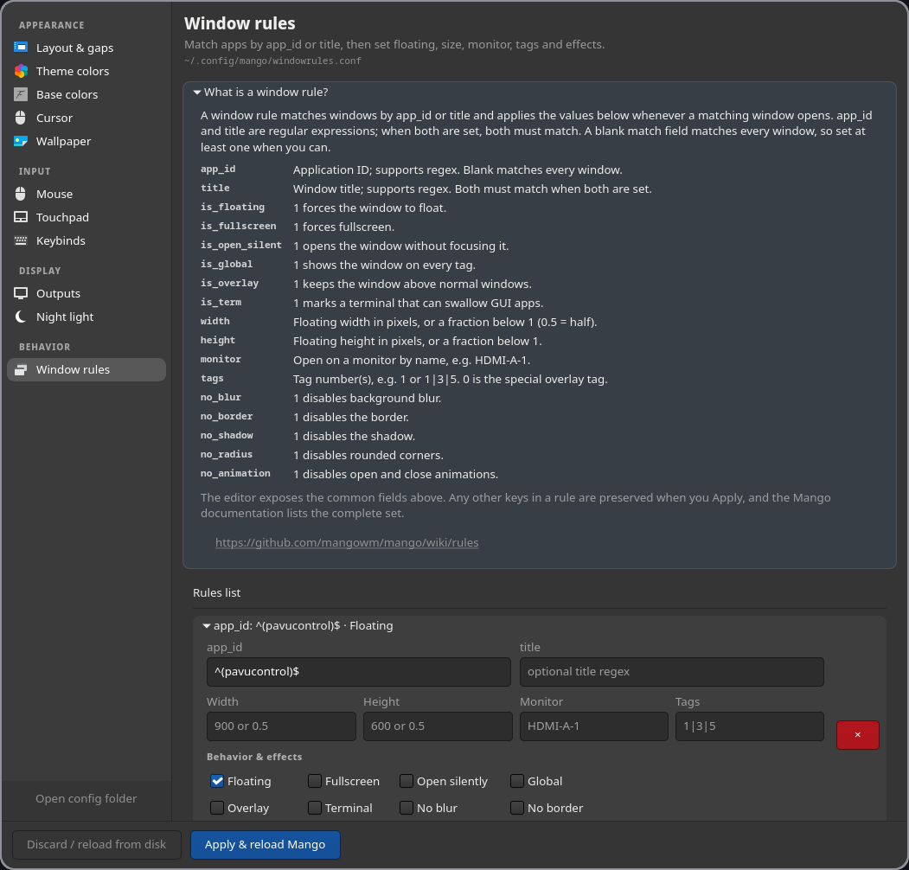

# mango-config

A friendly GTK4 settings app for the [Mango](https://github.com/DreamMaoMao/mango) Wayland compositor.


`mango-config` edits the Mango config files you already have. It does **not**
require DMS, does not replace your config, and never rewrites keys you did not
touch. Every Apply is validated and backed up.

## Screenshots

| Theme colors | Base colors |
|---|---|
|  |  |
| **Outputs** | **Keybinds** |
|  |  |
| **Wallpaper** | **Brightness** |
|  |  |
| **Default apps** | **Night light** |
|  |  |
| **Window rules** | |
|  | The collapsible help card, app matching, geometry, tags and effect toggles. |

## Features

- **Layout & gaps** — border radius, border width, inner/outer gaps.
- **Theme colors** — the extended palette from your theme, grouped into
  surfaces, accents, jump labels and group bar.
- **Base colors** — border, focus and urgent colors from the file that actually
  takes effect.
- **Cursor, mouse and touchpad** — size, theme, acceleration, scrolling,
  tapping and gesture options.
- **Wallpaper** — names on the left, a monitor-shaped live preview on the
  right, search and a current-wallpaper marker. Choose Fill, Fit, Stretch,
  Center or Tile, rotate in 90° steps, and flip horizontally or vertically.
  The fit is baked into a monitor-sized image so `swaybg` and the color helper
  display the same result. Uses `light-wallpaper` when available (palette
  sync), otherwise starts `swaybg`. A Fuzzel quick pick is included as an
  optional text-only shortcut.
- **Brightness** — a live slider under Display for this session. It prefers a
  local `light-brightness` helper (DDC/CI monitors), then `brightnessctl`,
  `light`, or a writable sysfs backlight. Nothing is written to the Mango
  config.
- **Default apps** — choose the terminal, file manager and web browser used for
  XDG links and folders. Saves to `~/.config/mimeapps.list`, preserves other
  associations, and backs up the existing file first. It does not rewrite
  Mango keybinds.
- **Outputs** — detected monitors, multiple `monitor_rule` entries, resolution,
  refresh rate, scale, position, transform, VRR, HDR, primary and Custom mode.
- **Night light** — live `gammastep` control under Display: enable, set a color
  temperature, and apply immediately. The last temperature is remembered.
- **Window rules** — match by `app_id` or `title`, then set floating,
  fullscreen, open silently, global, overlay, terminal swallowing, width,
  height, monitor, tags and effects (blur, border, shadow, radius, animation).
  A collapsible help card explains every field; unknown keys and untracked
  rules are preserved.
- **Keybinds** — searchable, grouped by compositor vs apps, keycap-style combos.
  Each action card can hold multiple shortcuts (for example `Super+Return` and
  `Super+T` for kitty); add or remove shortcuts, and edit the action or args
  once for the whole group. Shortcuts use one Combo field, so full chords such
  as `Super+Ctrl+P` and `Super+Shift+Alt+T` work directly.
- **Display guard** — after an output change, an inline 10-second countdown
  asks you to keep or revert. If the timer runs out, it reverts automatically.

Wallpaper, Brightness and Night light are separate from the global Apply flow.
Wallpaper and Default apps write their own state outside the Mango config;
Brightness and Night light are session-only.

## Requirements

- Mango Wayland compositor (running, for live reload and monitor detection)
- Python 3.10+
- GTK 4.10+ and PyGObject

Optional, for the extra pages:

- `gammastep` — Night light page.
- `swaybg` — Wallpaper page fallback. If `light-wallpaper` is on `PATH`, the
  app calls it instead so palette/shell sync keeps working.
- `fuzzel` — text-only Wallpaper quick pick.
- `light-brightness`, `brightnessctl` or `light` — Brightness page. A writable
  `/sys/class/backlight` device also works without an extra tool.
- GdkPixbuf, normally installed with GTK, is used for wallpaper fitting.

Install the toolkit on your distro:

```bash
# Fedora
sudo dnf install python3-gobject gtk4
# optional extras
sudo dnf install gammastep swaybg fuzzel

# Arch
sudo pacman -S python-gobject gtk4
# optional extras
sudo pacman -S gammastep swaybg fuzzel

# Ubuntu / Debian
sudo apt install python3-gi gir1.2-gtk-4.0
# optional extras
sudo apt install gammastep swaybg fuzzel
```

## Install

```bash
git clone https://github.com/deopr/mango-config.git
cd mango-config
./scripts/install.sh
```

The installer is user-level and needs no sudo. It installs:

- `~/.local/bin/mango-config`
- `~/.local/share/applications/io.github.deopr.MangoConfig.desktop`
- `~/.local/share/icons/hicolor/scalable/apps/io.github.deopr.MangoConfig.svg`

Then run `mango-config`, or launch **Mango Config** from your app launcher.

Manual install is just:

```bash
install -Dm755 mango-config ~/.local/bin/mango-config
```

## Config discovery

No configuration is required. The app reads `~/.config/mango/config.conf`,
follows `source=` and `source_optional=` includes, and identifies what each file
contains. This means it works with:

- one big `config.conf` with everything inline,
- a split config (`layout.conf`, `outputs.conf`, `binds.conf`, …),
- a DMS-generated config with `dms/*.conf` fragments,
- any custom directory, via `--config-dir` or `MANGO_CONFIG_DIR`.

Only files that Mango actually sources are edited. See
[docs/CONFIG-DISCOVERY.md](docs/CONFIG-DISCOVERY.md) for the details.

## Migrating a DMS layout

DMS users can keep their layout — the app reads it as-is. If you want to move
the sourced `dms/*.conf` fragments to the config root, opt in:

```bash
./scripts/install.sh --migrate-dms
```

This translates:

```
~/.config/mango/dms/layout.conf   ->  ~/.config/mango/layout.conf
~/.config/mango/dms/outputs.conf  ->  ~/.config/mango/outputs.conf
...
```

and rewrites the matching `source=` lines. It backs up everything under
`.autobak/migrate-<timestamp>/`, runs `mango -p`, and rolls the whole migration
back if validation fails. Unsourced files stay where they are.

> If you re-run `dms setup` later, DMS may recreate `dms/*.conf` and its own
> source lines. Keep the DMS layout instead if you rely on DMS managing it.

## How Apply works

1. Backs up every touched file to `<config>/.autobak/<timestamp>-<name>`.
2. Writes only controls whose values changed, and only keys that already exist
   in the file. New binds, rules and monitor rules are appended explicitly.
3. Runs `mango -p -c <config>/config.conf` and inspects the output (Mango can
   return success even when it printed an error).
4. On error, restores the snapshots and reloads the UI.
5. On success, sends `dispatch reload_config` to the Mango IPC socket. If no
   socket is available, it tells you to reload Mango yourself.

Output changes additionally show the inline keep/revert guard.

## CLI

```bash
mango-config                      # normal launch
mango-config --tab keys           # open a tab directly
mango-config --tab wallpaper      # names + fit options + live preview
mango-config --tab brightness     # screen brightness slider
mango-config --tab apps           # default terminal/file manager/browser
mango-config --tab night          # gammastep night light controls
mango-config --config-dir ~/dotfiles/mango
mango-config --no-reload          # write and validate only
mango-config --version
```

Tab IDs: `layout`, `theme`, `colors`, `cursor`, `wallpaper`, `mouse`,
`touchpad`, `keys`, `outputs`, `brightness`, `night`, `apps`, `rules`.

## Inspiration

This project was inspired by [HyprMod](https://github.com/BlueManCZ/hyprmod), a
native GTK4 settings app for Hyprland. We liked the idea of giving a Wayland
compositor a proper, friendly settings GUI, so we built the Mango version:
`mango-config`, with config auto-discovery, DMS support, and validated,
reversible applies.

## Limitations

- `config.toml` is detected but not edited yet. Use `config.conf`.
- When several sourced files contain binds, the app edits the file with the
  most binds. Other bind files are left untouched.
- Files generated by theme managers (Noctalia, DMS) can be regenerated by those
  tools. Override the values in a later source file if you need them permanent.
- The app edits text, not semantics: keep comments and unusual keys where they
  are, but always review the diff if you hand-edit around it.
- Night light and Brightness are session-only. They do not create autostart
  services; configure `gammastep` and your brightness tool for login behavior
  if you need it permanent.
- Wallpaper fitting targets the first monitor and the current monitor size.
  Re-apply after changing resolution or moving to a different monitor.
- Fuzzel is text-only, so the image preview lives in the Wallpaper page. The
  Fuzzel quick pick is there for keyboard-first use.

## Development

The app is a single Python file, `mango-config`. Run it directly:

```bash
python3 ./mango-config --config-dir /tmp/mango-test
```

Tests:

```bash
python3 tests/test_discovery.py
xvfb-run -a python3 tests/test_apply.py
bash tests/test_install.sh
```

The test suite creates throwaway config directories and never touches your real
Mango config.

## License

MIT — see [LICENSE](LICENSE).
